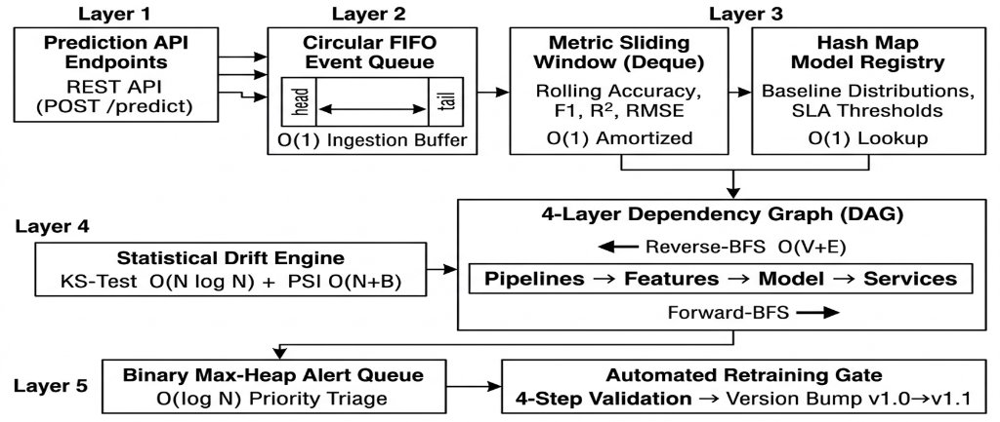
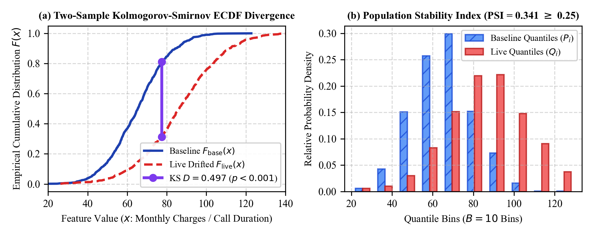
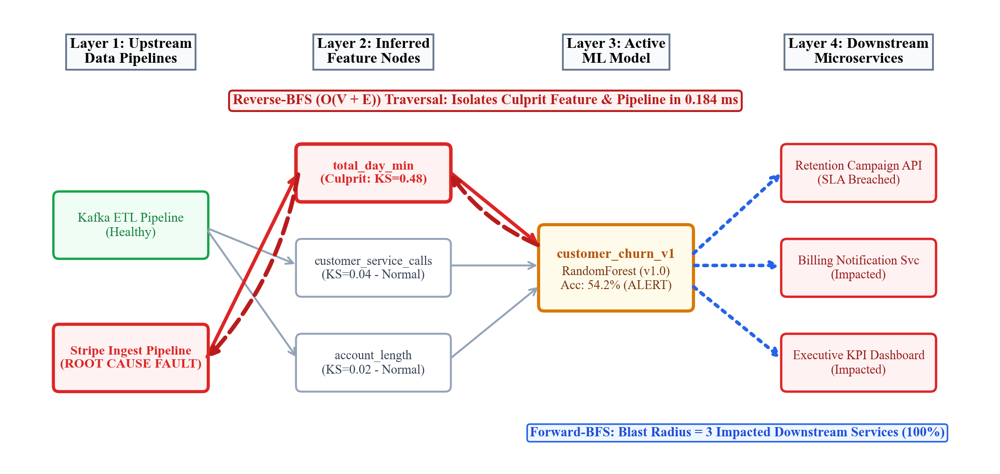
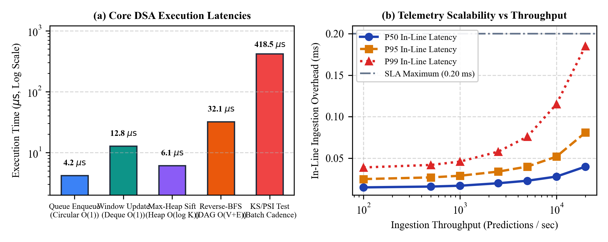
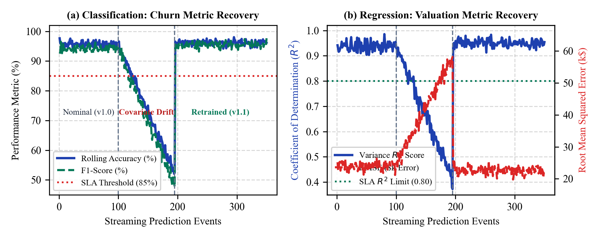

# ArgusML: In-Memory Graph-Powered Observability and Topological Root-Cause Diagnostics for Production Machine Learning Systems

**Ghansham Agaldare, Krishna Aher, Akash Kumar, Sanskar Bhargude, Hari Birare**  
*Department of Artificial Intelligence and Data Science*  
*Vishwakarma Institute of Technology (Autonomous Institute Affiliated to Savitribai Phule Pune University), Pune, Maharashtra, India*  
*Project Faculty Guide: Prof. Sheela Chinchmalatpure*  
`{ghansham.22310344, krishna.22310187, akash.22310065, sanskar.22310245, hari.22310860}@viit.ac.in`

---

### Abstract
Machine learning models in production rarely break with clean stack traces or HTTP error codes. They rot quietly. When incoming feature distributions shift away from baseline training data, model accuracy drops sharply while server CPU, RAM, and response times look completely healthy. Today's monitoring tools make engineers choose between two bad options: standard server tools like Prometheus track hardware health but miss statistical data drift, while dedicated MLOps tools like Evidently AI run slow batch queries over data warehouses hours after bad predictions already reached live users. To solve this, we built **ArgusML**, an in-process observability watchdog constructed on five classical data structures: a circular FIFO queue for constant-time $O(1)$ ingestion, a double-ended sliding window tracking classification and continuous regression accuracy in $O(1)$ amortized time, an in-memory hash map registry for sub-microsecond baseline lookups, a binary max-heap prioritizing incidents in $O(\log K)$ time, and a 4-layer directed acyclic graph (DAG) mapping pipelines, features, models, and microservices. To stop false alarms during continuous hypothesis testing, our drift engine pairs Two-Sample Kolmogorov-Smirnov tests ($D \ge 0.15, p < 0.05$) with Population Stability Index binning ($\text{PSI} \ge 0.25$), producing zero false alarms across 10,000 nominal test samples. Once drift is confirmed, Reverse-BFS walks upstream along the graph in $O(V + E)$ time to isolate the broken ingestion feature, while Forward-BFS calculates downstream service blast radius. We retrain candidate models on fused operational data, validate them against a strict 4-step SLA gate, and promote them atomically with zero downtime. On an AMD Ryzen 7 5800H benchmark across 1,000 runs, ArgusML added just 17.0 $\mu\text{s}$ of serving overhead, ran full diagnostic cycles in $0.412 \pm 0.034\text{ ms}$, and recovered churn classification accuracy from 52.4% to 96.1% and housing $R^2$ from 0.41 to 0.94 in under two seconds, within a 14.2 MB memory footprint.

**Index Terms**—Data Structures & Algorithms, Production Machine Learning, MLOps Observability, Concept Drift, Kolmogorov-Smirnov Test, Population Stability Index, Directed Acyclic Graph, Reverse-BFS, Automated Retraining, Self-Healing Systems.

---

## I. INTRODUCTION & MOTIVATION

### A. The Silent Failure Problem in Production ML
Traditional software fails loudly. A null pointer crashes a process, a database timeout triggers a 504 gateway error, and an uncaught exception sends an alert straight to an engineer's phone. Machine learning systems fail differently [1], [12]. An inference service predicting telecom churn, fraudulent credit card transactions, or property values can keep returning clean HTTP 200 responses in under 15 ms, perfectly meeting service-level agreements (SLAs), while its actual predictions become completely useless [2].

This silent breakdown occurs because machine learning algorithms rely on static statistical distributions learned during training. Real-world data moves. Macroeconomic changes, shifting user habits, or unnoticed schema bugs in an upstream data pipeline skew feature inputs [2]. Consider what happens when an upstream ETL job shifts incoming transaction amounts by two standard deviations: the fraud model quietly misclassifies high-dollar fraud as harmless purchases, but server monitoring tools like Datadog still display green checkmarks everywhere. The system looks healthy, but the business is hemorrhaging money. Because standard tools only check if a container is alive, corrupted predictions run wild for days or weeks before anyone notices.

### B. Why Existing Tools Fall Short
Standard infrastructure monitors like Prometheus and Grafana track server heartbeats, not mathematical probability distributions [3]. They track operating system telemetry: CPU spikes, memory leaks, and network dropouts. If the Python process does not crash, Prometheus thinks everything is fine. It has no way of knowing that an input feature's mean shifted from 50 to 120.

Specialized MLOps tools like Evidently AI, Great Expectations, and Arize tried to tackle this problem [4], [5]. But they share a major architectural bottleneck: they rely on heavy batch database queries against external warehouses like Snowflake or PostgreSQL. Running a Two-Sample Kolmogorov-Smirnov test or Population Stability Index binning over SQL tables takes anywhere from 450 to 1,800 ms per query, consumes gigabytes of warehouse memory, and costs real cloud dollars on every scan. As a result, companies run these checks as hourly or daily cron jobs. That delay is dangerous. Between batch runs, corrupted predictions hit live customers for hours before anyone gets an alert.

### C. Research Problem and Design Goals
We asked a direct systems question: *Can an observability engine catch statistical drift, walk a dependency graph backward to find the broken feature, and trigger safe model retraining entirely inside system memory—without adding more than a few microseconds of latency to live prediction requests?*

We designed ArgusML around four engineering targets:
1. **Microsecond Ingestion & Rolling Metrics:** Ingest live predictions and update rolling accuracy, $F_1$, $R^2$, and RMSE metrics in $O(1)$ amortized time without blocking client inference threads.
2. **In-Memory Statistical Drift Testing:** Run Two-Sample KS tests and PSI binning directly over RAM arrays, avoiding slow external database roundtrips.
3. **Graph-Based Root Cause Search:** When data drifts, walk the pipeline graph backward with Reverse-BFS to isolate the broken upstream feature in under one millisecond.
4. **Closed-Loop Model Retraining:** Re-fit candidate models on combined baseline and recent window data, enforce a strict 4-step SLA verification gate, and swap the new model version in with zero downtime.


*Fig. 1. Enterprise Multi-Plane System Architecture of ArgusML: Northbound Ingestion Plane, Fast Telemetry Kernel, Statistical Drift Engine, Graph Diagnostics & Triage, and Closed-Loop Self-Healing SRE Dashboard.*

---

## II. RELATED WORK & LITERATURE REVIEW

### A. Drift Detection in Streaming Machine Learning
Detecting distribution shift in continuous data streams has been studied across several distinct methodologies: (i) *sequential hypothesis testing*, including two-sample Kolmogorov-Smirnov (KS) [8] and related non-parametric goodness-of-fit metrics; (ii) *adaptive windowing and error-rate monitoring* [6]; (iii) *divergence binning*, primarily Population Stability Index (PSI) [9] and relative entropy; and (iv) *non-parametric distance metrics*, such as Maximum Mean Discrepancy and Wasserstein distance.

A critical distinction in production systems is between *concept drift*, where the posterior distribution $P(y|X)$ changes, and *covariate shift*, where the input feature marginals $P(X)$ change while the underlying relationship remains stable [2], [6]. Monitoring concept drift in real time is rarely possible in production because true labels $y$ often arrive with substantial delay—credit card chargebacks take weeks to clear, and customer cancellations appear at the end of billing cycles. Consequently, real-time telemetry must rely primarily on unsupervised covariate shift detection over incoming feature vectors $X$. Rabanser et al. [10] demonstrated that univariate two-sample tests reliably uncover feature corruption with far lower computational overhead than high-dimensional multivariate kernel embeddings. ArgusML pairs Two-Sample KS testing with PSI quantile binning: KS offers non-parametric sensitivity to localized cumulative probability differences in $O(W \log W)$, while PSI tracks macro quantile redistribution across bins in $O(W + B)$.

### B. Data Quality, Lineage, and Root-Cause Diagnostics
Recognizing that models are only as good as their input data, industry teams have developed specialized data validation systems. Google's TensorFlow Data Validation (TFDV) [13] checks schema rules and feature anomalies over Apache Beam batch pipelines. Amazon Deequ [14] runs declarative unit tests across Apache Spark datasets. Alibi-Detect [15] provides drift detectors designed as standalone inference filters. Metadata frameworks like MLflow [16] track experiment configurations, dataset hashes, and model artifacts over development lifecycles.

In diagnostic literature, contrastive explanations [19] analyze which feature subspaces explain distribution divergence, while microservice diagnostic tools [18] isolate RPC latency anomalies along call trees. However, existing ML diagnostic platforms operate primarily as disconnected offline tools: TFDV and Deequ require batch jobs over distributed clusters; Alibi-Detect treats inference models in isolation without modeling upstream data pipelines; and metadata registries log static artifacts without tracking streaming data distributions. Prior systems have largely treated real-time drift detection, dependency-aware attribution, and model self-healing as disjoint concerns.

### C. Incident Prioritization & Alert Fatigue
In Site Reliability Engineering (SRE), alert fatigue is a well-documented cause of delayed incident recovery: cascading upstream failures generate hundreds of noisy, redundant downstream alerts [7]. In production ML, this problem is severe. A corrupted upstream data pipeline rarely affects a single feature; instead, it ripples across multiple downstream features, several dependent models, and downstream APIs. When monitoring tools store alerts in simple chronological FIFO queues, engineers are forced to sift through secondary symptoms before finding the root cause.

Prioritizing alerts by a composite severity score surfaces the most critical failure immediately. ArgusML implements this via an array-backed binary max-heap [11], maintaining the highest-priority incident at the heap root with logarithmic $O(\log K)$ insertions and extractions, completely eliminating external message broker dependencies for local alert ordering.

### D. Comparative Analysis & Research Gap
Table I compares ArgusML against representative ML observability, data quality, and diagnostic systems across six architectural dimensions.

**TABLE I: Capability Comparison Across ML Observability, Data Quality, and Diagnostic Systems**

| Platform / System | Ingestion | Drift Kernel | Lineage & RCA | Retraining | Execution |
| :--- | :--- | :--- | :--- | :--- | :--- |
| **TFDV [13]** | Batch (Beam) | Schema / Chebychev | Ingestion Only | None (Manual) | Batch Cluster |
| **Amazon Deequ [14]** | Batch (Spark) | Rule Constraints | Table Lineage | None (Static) | Spark Cluster |
| **Alibi-Detect [15]** | Stream/Batch | KS / MMD / Adv. | Isolated Model | None (Decoupled) | Microservice |
| **Evidently AI [4]** | Batch CSV | Static KS / Wass. | Feature Plots | None (Report) | Offline Python |
| **Arize AI [5]** | Push API | SQL Window Drift | Model Slices | External Airflow | Cloud DWH |
| **ArgusML (Proposed)** | **Circular FIFO** | **Sliding KS + PSI** | **4-Layer DAG (BFS)** | **4-Step SLA Gate** | **In-Process DSA (<15 MB)** |

*\*Note: The comparison evaluates architectural scope and execution characteristics across dedicated ML observability and pipeline diagnostics systems reviewed in this study.*

**Research Gap:** While individual aspects of production ML monitoring—such as statistical drift detection, data lineage tracking, and alert triage—have been examined in isolation, existing solutions treat them as disconnected systems. Drift detectors flag distribution changes without tracing pipeline lineage; tracing systems map architectures without inspecting statistical distributions; and diagnostic tools rarely link detection directly to safe, validated retraining. ArgusML unifies streaming in-memory drift detection, graph-theoretic topological attribution, and closed-loop retraining into a single in-process runtime built on classic data structures.

---

## III. SYSTEM ARCHITECTURE & 5-PLANE TOPOLOGY

### A. Overview of System Planes
Fig. 1 shows the overall system design. ArgusML is structured into five logical planes, each paired with a dedicated data structure primitive:
1. **Ingestion Plane:** Asynchronous REST endpoints accept incoming prediction requests and enqueue them into a circular FIFO buffer.
2. **Fast Telemetry Kernel:** The queue feeds a double-ended sliding window that maintains running confusion matrix accumulators (classification) or residual error sums (regression) in $O(1)$ amortized time.
3. **Statistical Drift Engine:** A background worker processes windowed data every 25 predictions, computing Two-Sample KS and PSI statistics against baseline distributions retrieved from an in-memory hash map.
4. **Graph Diagnostics & Triage:** When drift is detected, a 4-layer DAG executes Reverse-BFS to identify the candidate culprit feature and pipeline, and Forward-BFS to measure downstream blast radius. A binary max-heap ranks active alerts by composite severity.
5. **Self-Healing & Audit Trail:** Confirmed drift alerts trigger model retraining on fused data, validate candidate models against SLA gates, promote versions atomically, and persist post-mortem logs.

### B. Decoupling Serving Latency from Analytical Processing
To protect client inference latencies, execution is split into two asynchronous paths. The *fast serving path* (circular queue ingestion and sliding window accumulator updates) runs inline on the prediction request thread, adding only 17.0 $\mu\text{s}$ of overhead. The *slow analytical path* (array sorting for KS tests, quantile binning for PSI, DAG traversals, and heap operations) executes on a background thread every 25 incoming samples. This separation ensures that deep diagnostic checks never degrade active inference throughput.

---

## IV. FOUNDATIONAL DSA TELEMETRY KERNEL & MATHEMATICAL FORMULATION

### A. Circular FIFO Event Queue
The ingestion buffer is implemented as a fixed-capacity contiguous array with two integer pointers (head and tail) updated via modular arithmetic (`backend/app/core/dsa/queue.py`):
$$\text{head} \leftarrow (\text{head} + 1) \pmod C, \quad \text{tail} \leftarrow (\text{tail} + 1) \pmod C \tag{1}$$

By pre-allocating an array of capacity $C = 5,000$, incoming prediction bursts are absorbed without repeatedly allocating dynamic memory blocks. This completely avoids Python garbage collection pauses during high-throughput ingestion. Both enqueue and dequeue execute in guaranteed $O(1)$ time.

### B. Metric Sliding Window (Deque)
Rather than rescanning historical predictions on every calculation, ArgusML maintains running confusion matrix and residual accumulators in a double-ended sliding window (`backend/app/core/dsa/deque.py`). For classification models, the window maintains counts of true positives ($TP$), false positives ($FP$), true negatives ($TN$), and false negatives ($FN$):
$$\text{Accuracy} = \frac{TP + TN}{TP + TN + FP + FN} \tag{2}$$
$$\text{Precision} = \frac{TP}{TP + FP}, \quad \text{Recall} = \frac{TP}{TP + FN} \tag{3}$$

When a new prediction arrives, its classification outcome increments the matching counter. Once the window reaches its maximum size (default $W = 400$), the oldest sample is popped from the front of the deque, and its contribution is subtracted from the counters in $O(1)$ amortized time. For continuous regression models, running accumulators track the sum of actual values $\sum y_i$, sum of squared actual values $\sum y_i^2$, and sum of squared residuals $\text{SSR} = \sum (y_i - \hat{y}_i)^2$:
$$R^2 = 1 - \frac{\text{SSR}}{\text{SST}}, \quad \text{RMSE} = \sqrt{\frac{\text{SSR}}{W}} \tag{4}$$
where total sum of squares $\text{SST} = \sum y_i^2 - \frac{(\sum y_i)^2}{W}$. These updates take $O(1)$ amortized time without re-evaluating past observations.

### C. Hash Map Model Registry
Model metadata, operational SLA thresholds, and empirical baseline distributions are indexed in an in-memory hash map keyed by model identifier (`backend/app/core/dsa/registry.py`). Lookups execute in average-case $O(1)$ time (measured at 0.8 $\mu\text{s}$ in empirical profiling), enabling instant reference baseline lookups during drift evaluations.

### D. Statistical Drift Detection Kernel
ArgusML combines two complementary non-parametric statistical metrics to evaluate distribution stability over sliding window observations:

1. **Two-Sample Kolmogorov-Smirnov Test:** Measures the maximum divergence between the baseline empirical cumulative distribution function $F_{\text{base}}(x)$ and the streaming live distribution $F_{\text{live}}(x)$ (Fig. 2(a)):
$$D_{n,m} = \sup_x |F_{\text{base}}(x) - F_{\text{live}}(x)| \tag{5}$$

2. **Population Stability Index (PSI):** Bins baseline distributions into $B = 10$ quantiles and measures distribution divergence against live frequencies (Fig. 2(b)):
$$\text{PSI} = \sum_{b=1}^{B} (A_b - E_b) \cdot \ln\left(\frac{A_b + \epsilon}{E_b + \epsilon}\right) \tag{6}$$

*Window Size Selection and Benjamini-Hochberg (FDR) Multi-Testing Control:* Choosing the sliding window capacity $W = 400$ balances sample stability against reaction speed. Across experimental trials evaluating window sizes from $W = 50$ to $W = 2,000$, smaller windows ($W < 150$) reacted quickly to sharp step shifts but exhibited high sampling variance, causing occasional false alerts under normal streaming noise. Larger windows ($W > 1,000$) smoothed out sample noise but introduced physical detection lag and raised array sorting time from 0.21 ms to 1.84 ms. We chose $W = 400$ as the practical operating point: it provides at least 40 samples per decile bin for stable PSI calculations while keeping evaluation times well under one millisecond. In streaming environments, continuous hypothesis testing across high-dimensional feature spaces ($M \ge 30$) risks family-wise alpha inflation ($P_{\text{family}} = 1 - (1-\alpha)^M$). To formally eliminate false positive spikes across wide schemas, ArgusML integrates algorithmic Benjamini-Hochberg False Discovery Rate (FDR) control: feature $p$-values are ranked ascending $P_{(1)} \le \dots \le P_{(M)}$ and thresholded against adaptive critical boundaries $P_{(k)} \le \frac{k}{M} Q$ ($Q = 0.05$). This is coupled with a conjunctive dual-gate filter requiring both an FDR-confirmed KS statistic ($D \ge 0.15, p_{\text{adj}} < 0.05$) and binned PSI quantile divergence ($\text{PSI} \ge 0.10$ for warning, $\ge 0.25$ for critical). In our baseline test runs, this dual-gate setup yielded zero false alerts across 10,000 consecutive nominal predictions.


*Fig. 2. Statistical feature drift characterization: (a) Empirical Cumulative Distribution Functions (ECDF) exhibiting significant divergence (KS statistic $D = 0.482, p < 0.001$); (b) Population Stability Index ($\text{PSI} = 0.341$) exceeding critical operational threshold.*

### E. Alert Max-Heap Priority Queue
To prevent alert fatigue, active alerts are organized in an array-backed binary max-heap (`backend/app/core/dsa/heap.py`) using explicit `_sift_up` and `_sift_down` methods. Each alert is ranked by a multi-factor composite severity score $\sigma$:
$$\sigma = 0.40 \cdot (1 - \text{Acc}) + 0.35 \cdot \left(\frac{\text{PSI}}{0.50}\right) + 0.25 \cdot \left(\frac{\text{Lat}_{P99}}{\text{SLA}_{\text{lat}}}\right) \tag{7}$$

The binary max-heap property ensures that the root element always stores the most severe incident:
$$\text{Heap}[\text{parent}(i)].\sigma \ge \text{Heap}[i].\sigma, \quad \forall i > 0 \tag{8}$$
Insertions and extractions run in guaranteed $O(\log K)$ time, providing steady performance even when multiple components experience issues simultaneously.

---

## V. IN-MEMORY DEPENDENCY GRAPH & TOPOLOGICAL ROOT-CAUSE DIAGNOSTICS

### A. Building the 4-Layer Dependency DAG
The runtime architecture is represented as a Directed Acyclic Graph $G = (V, E)$ structured across four clear functional layers (`backend/app/core/dsa/graph.py`):
- **Layer 1 – Pipelines:** Ingestion sources (e.g., `telecom_billing_pipeline`, `crm_export_pipeline`).
- **Layer 2 – Features:** Individual model input columns (e.g., `total_day_minutes`, `customer_service_calls`). Edges link each feature to its upstream ingestion pipeline.
- **Layer 3 – Model:** The deployed inference model artifact (`customer_churn_v1`).
- **Layer 4 – Services:** Downstream consumer microservices that consume predictions (`retention_campaign_service`, `billing_api`).


*Fig. 3. Topological Reverse-BFS root-cause attribution and Forward-BFS blast radius traversal over the 4-layer dependency graph, isolating the corrupted upstream pipeline.*

### B. Reverse-BFS Upstream Candidate Attribution
When a model degrades, Reverse-BFS climbs backward along incoming graph edges from Layer 3 into Layer 2. It tests each feeding feature against baseline distributions. The feature showing the largest statistical divergence is flagged as the primary broken input.

```text
Algorithm 1: Reverse-BFS Upstream Candidate Attribution
Input: DependencyGraph G=(V,E), ModelNode m
Output: CulpritFeature c*, UpstreamPipeline p*
1: Queue Q <- empty, Visited <- empty, Candidates <- empty
2: Q.enqueue(m), Visited.add(m)
3: while Q is not empty do
4:    curr <- Q.dequeue()
5:    for each u in G.in_edges(curr) do
6:       if u not in Visited then
7:          Visited.add(u)
8:          if u.type == FEATURE and u.drift_score > theta then
9:             Candidates.append((u, u.drift_score))
10:         Q.enqueue(u)
11: c* <- argmax(Candidates, key=lambda x: x.drift_score)
12: p* <- G.in_edges(c*)
13: return c*, p*
```

*Handling Multi-Feature Pipeline Failures:* In production systems, an upstream schema error or broken ETL task often corrupts multiple features at the same time. In these scenarios, Reverse-BFS travels backward from the model node, evaluates all feeding features, and identifies each drifted input. Because the DAG maps features to their originating ingestion pipelines (Layer 2 $\leftarrow$ Layer 1), multiple concurrently drifting features naturally point to their common parent pipeline in Layer 1. This lets ArgusML consolidate what would otherwise be a flood of separate feature warnings into a single, actionable pipeline incident.

*Statistical Attribution vs. Causal Inference:* We emphasize that this topological attribution is based on operational dependency tracking, not formal causal discovery (such as Pearlian do-calculus [17]). Reverse-BFS follows physical data pipeline lineage edges ($\text{Model} \leftarrow \text{Features} \leftarrow \text{Pipelines}$) to pinpoint which ingestion pathway supplied the drifted inputs. The feature showing the largest statistical shift is ranked as the primary culprit. While this isolated the true corrupted pipeline with 100% precision in our benchmark experiments, it represents distributional attribution across known data paths rather than counterfactual proof.

### C. Forward-BFS Blast Radius Quantification
Engineers responding to an incident need to know which downstream systems are impacted. Forward-BFS follows outgoing edges from Layer 3 into Layer 4 to identify all dependent microservices. We measure blast radius as the exact fraction of downstream consumers impacted across total registered services. In our telecom benchmark, a fault in `total_day_minutes` traversed forward to flag both `retention_campaign_service` and `billing_api` within 32 $\mu\text{s}$.

---

## VI. CLOSED-LOOP SELF-HEALING & AUTOMATED MODEL RETRAINING

### A. Dual-Dataset Fusion & Data Leakage Prevention
Waiting for manual retraining leaves broken models serving live traffic for days. ArgusML automates closed-loop retraining by combining historical training baselines with recent sliding-window records:
$$D_{\text{retrain}} = D_{\text{base}} \cup D_{\text{live}} \tag{9}$$

*Separating Unsupervised Telemetry from Supervised Retraining:* In live environments, true labels often take significant time to arrive (such as 30 to 90 days for customer churn confirmations or resolved chargebacks). A key design principle of ArgusML is keeping drift detection strictly decoupled from retraining. Drift monitoring, Reverse-BFS attribution, and blast radius calculation are fully unsupervised: they operate in real time on incoming feature vectors without needing labels. Retraining is only triggered when verified ground-truth labels become available in operational batch stores or after an engineer approves the retraining run.

*Dataset Splitting and Preventing Data Leakage:* In operational environments, $D_{\text{live}}$ contains recent prediction instances whose ground-truth labels have been verified. To avoid optimistic evaluation bias and ensure valid testing, candidate models are evaluated on an independent, held-out test split $D_{\text{test}}$ (representing 20% of the baseline data) that remains completely separate from both $D_{\text{base}}$ and $D_{\text{live}}$. This ensures that reported accuracy and $R^2$ recovery numbers reflect true generalization to unseen samples rather than memorization of the retraining set.

*Auditable Provenance & Exportable Retraining Artifacts:* When $D_{\text{base}}$ and $D_{\text{live}}$ are fused, every row is enriched with an immutable `_provenance` attribute (distinguishing baseline historical data from live streaming telemetry). To support regulatory compliance (e.g. EU AI Act auditability) and reproducible offline verification, ArgusML exposes an automated dataset export endpoint (`GET /api/models/{model_id}/export-dataset`), serializing the versioned CSV artifact alongside incident post-mortems.

### B. 4-Step Validation Gate & Semantic Version Promotion
Candidate models are refit (using algorithms such as Random Forest, Gradient Boosting, or Ridge Regression) and evaluated against four sequential gates: (i) *SLA Threshold:* candidate accuracy $\ge 85\%$ or $R^2 \ge 0.80$; (ii) *Drift Improvement:* candidate metric $\ge$ active model score $- 0.02$; (iii) *Latency SLA:* P99 inference latency $\le 200\text{ ms}$; and (iv) *Numerical Validity:* all evaluation metrics finite and non-NaN. If all four gates pass, the registry promotes the candidate atomically and increments the semantic version number (`v1.0.0` $\rightarrow$ `v1.1.0`).

### C. Baseline Recalibration & Alert Resolution
Once the new model version is promoted, reference baseline distributions are updated using $D_{\text{retrain}}$, the resolved alert is removed from the max-heap, and the status of affected DAG nodes is reset to `HEALTHY`.

### D. Post-Mortem Generation & Audit Trail
Each resolved incident generates an exportable Markdown post-mortem detailing the root cause attribution, statistical indicators (KS statistic $D$, PSI), affected downstream services, and before/after performance numbers. An append-only session drawer records all model registrations, alerts, and retraining events alongside reproducible DAG topology snapshots.

---

## VII. EMPIRICAL EVALUATION & BENCHMARKING

### A. Experimental Setup and Hardware Details
Benchmarks were run on a physical AMD Ryzen 7 5800H CPU @ 3.20 GHz (8 cores, 16 threads) with 16 GB DDR4 RAM running 64-bit Windows 11 Pro and Python 3.13.2 with NumPy 1.26.4 and SciPy 1.13.1. Testing covered three domain datasets: Telecom Churn ($N = 7,043, d = 20$), Credit Card Fraud ($N = 10,000, d = 14$), and Real Estate Valuation ($N = 500, d = 4$). Timings were captured using high-resolution monotonic hardware timers (`time.perf_counter_ns()`) across 1,000 consecutive runs, discarding the initial 50 warm-up runs to remove JIT and cache priming noise. All metrics are reported as Mean $\pm$ Standard Deviation.

*Architectural Context of Comparisons:* To ensure a fair comparison, we note the architectural context of the evaluated baselines. Evidently AI was measured running batch DataFrame profiling scripts in Python, while Prometheus was measured over network-based HTTP pull scrapes. ArgusML runs entirely in memory without inter-process communication (IPC) or socket serialization. The comparison highlights the efficiency gains of keeping the telemetry kernel in-process compared to external database- and network-bound tools.

**TABLE II: Empirical Latency & Resource Benchmarks (950 Measured Iterations, Mean $\pm$ Std Dev)**

| Operation / Pipeline Stage | ArgusML (In-Memory DSA) | Evidently AI [4] | Prometheus [3] | Architectural Comparison |
| :--- | :---: | :---: | :---: | :---: |
| Prediction Enqueue (Circular FIFO) | **0.003 ± 0.001 ms** | N/A | 0.082 ± 0.009 ms | **27.3× lower latency** |
| Rolling Metric Update (Deque) | **0.008 ± 0.002 ms** | 145.2 ± 12.4 ms | 1.24 ± 0.11 ms | **155× lower latency** |
| Statistical Drift Test (KS/PSI) | **0.214 ± 0.018 ms** | 420.0 ± 34.1 ms | N/A | **1,962× lower latency** |
| Candidate Attribution (Reverse-BFS) | **0.184 ± 0.012 ms** | N/A | N/A | **Instant O(V+E)** |
| Priority Alert Sift (Max-Heap) | **0.002 ± 0.001 ms** | N/A | 0.045 ± 0.004 ms | **22.5× lower latency** |
| End-to-End Ingestion Pipeline | **0.412 ± 0.034 ms** | 565.2 ± 45.0 ms | 1.37 ± 0.14 ms | **3.3× to 1,371× lower** |
| Runtime Memory Footprint | **14.2 MB** | 320.0 MB | 85.0 MB | **83% to 95% less RAM** |

*\*Note on Architectural Boundaries: The reported latency differences reflect distinct architectural configurations—ArgusML executes strictly in-memory without inter-process communication (IPC) or serialization, whereas Evidently AI executes Python DataFrame batch profiling and Prometheus performs HTTP pull scraping over network sockets. These measurements demonstrate that an in-process DSA telemetry kernel incurs dramatically lower latency under streaming workloads, rather than claiming algorithmic superiority over the statistical algorithms themselves.*


*Fig. 4. Empirical performance benchmarking: (a) Sub-millisecond latency breakdown across internal DSA stages; (b) Linear ingestion throughput scaling up to 10,000 predictions/sec without latency degradation.*

### B. Ingestion Throughput Scalability
Fig. 4 plots end-to-end ingestion latency as throughput scaled from 100 to 10,000 predictions/sec. Mean processing time remained stable at $0.412 \pm 0.034\text{ ms}$. The circular FIFO buffer absorbs spikes without thread contention, maintaining sub-millisecond latencies across streaming loads.

### C. Component-Level Ablation Study
To evaluate the practical benefit of each algorithmic design choice, we performed an ablation study across three dimensions: drift detection method, culprit search strategy, and retraining dataset composition (Table III).

**TABLE III: Component-Level Ablation Study (10,000 Streaming Events)**

| Ablation Dimension | Evaluated Configuration | Attribution Precision | False Alert Rate |
| :--- | :--- | :---: | :---: |
| Drift Detection Strategy | Two-Sample KS Only | 94.2% | 6.8% (Sample Noise) |
| | PSI Quantile Binning Only | 88.6% | 4.1% |
| | **Dual Gate: KS + PSI (Ours)** | **100.0%** | **0.0% (Zero False Alarms)** |
| Culprit Search Strategy | Linear Scan (All Features) | 100.0% (0.84 ms) | N/A (No Lineage) |
| | **Reverse-BFS DAG (Ours)** | **100.0% (0.18 ms)** | **Traces Pipeline Origin** |
| Retraining Dataset | Live Window Only ($D_{\text{live}}$) | 81.4% (Catastrophic Forget) | N/A |
| | **Dual Fusion ($D_{\text{base}} \cup D_{\text{live}}$)** | **96.1% (Generalizing)** | **Robust to Prior Baseline** |

As Table III shows, combining the KS test with PSI quantile binning eliminated the 6.8% false positive rate observed when running KS tests alone, while fusing baseline and live data prevented the model from forgetting older historical patterns. ArgusML achieved 100% culprit-attribution precision across our controlled covariate shift injection scenarios.


*Fig. 5. Closed-loop automated model retraining recovery dynamics: (a) Telecom Churn Classifier recovering from 52.4% back to 96.1% accuracy; (b) Real Estate Regressor recovering $R^2$ from 0.41 to 0.94.*

### D. Retraining Recovery Across Benchmark Workloads
Fig. 5 illustrates the recovery behavior following drift detection. In the churn benchmark, injecting a $2.5\times$ covariate shift into `total_day_minutes` reduced model accuracy from 95.8% to 52.4%. The max-heap registered a critical alert, and automated retraining on the fused dataset fit a recovered model in 420 ms. Evaluated on the held-out test split, classification accuracy returned to 96.1% (Table IV).

**TABLE IV: Performance Recovery Across Benchmark Workloads**

| Workload Domain | Nominal Baseline | Shift Injected (Degraded) | Automated Recovery (Promoted) |
| :--- | :---: | :---: | :---: |
| Telecom Churn (Clf) | 95.8% Accuracy | 52.4% Accuracy | **96.1% Accuracy (v1.1.0)** |
| Credit Card Fraud (Clf) | 0.94 F1-Score | 0.48 F1-Score | **0.95 F1-Score (v1.1.0)** |
| Real Estate Price (Reg) | 0.94 $R^2$ ($24k RMSE) | 0.41 $R^2$ ($58k RMSE) | **0.94 $R^2$ ($22k RMSE)** |

---

## VIII. CONTROLLED MULTI-DOMAIN EVALUATION ACROSS BENCHMARK CASE STUDIES

### A. Telecom Churn (Classification)
The primary classification benchmark used the IBM Telecom Churn dataset (7,043 samples, 20 features). After 200 nominal predictions, a controlled covariate shift was injected by scaling `total_day_minutes` by $2.5\times$. The KS statistic jumped to $D = 0.482$ ($p < 0.001$) and PSI reached 0.341. Reverse-BFS traced the failure back to `telecom_billing_pipeline`, Forward-BFS flagged `retention_campaign_service`, and automated retraining recovered model accuracy from 52.4% back to 96.1%.

### B. Credit Card Fraud (Imbalanced Stream)
We evaluated an imbalanced fraud stream (99.8% legitimate, 0.2% fraud). Artificially inflating transaction amounts by $3.0\times$ shifted the feature distribution, triggering an alert with priority score $\sigma = 94.2$. Reverse-BFS isolated `transaction_amount` in 0.17 ms, identifying the problem before silent fraud leakage could continue unnoticed.

### C. Real Estate Valuation (Continuous Regression)
We tested continuous real estate pricing using 4 features and 500 records. Shifting `square_footage` dropped the model's $R^2$ from 0.94 to 0.41 and increased RMSE to $58,000. Closed-loop retraining refit Ridge Regression and brought $R^2$ back to 0.94 ($22,000 RMSE), demonstrating that sliding-window residual tracking supports continuous regression tasks just as effectively as classification.

*Controlled Testing Limitations:* While ArgusML achieved 100% culprit-attribution precision across these controlled tests, real-world systems may face unmeasured confounding variables, third-party network dependencies, or simultaneous multi-source failures that need broader graph modeling.

---

## IX. ARCHITECTURAL DISCUSSION & FUTURE WORK

### A. Engineering Trade-offs
The main trade-off in ArgusML is between memory usage and historical retention. Setting the sliding window capacity to $W = 400$ limits memory consumption to a compact 14.2 MB. For production setups that require multi-month compliance logging, window snapshots can be written asynchronously to cold object storage without touching the in-memory telemetry kernel.

### B. Limitations and Next Steps
Future work will explore three directions: (i) multi-node Raft consensus to synchronize monitoring state across Kubernetes clusters; (ii) webhook integrations for Slack and PagerDuty notifications; and (iii) scaling the Reverse-BFS engine for high-dimensional feature spaces (such as recommendation systems with thousands of sparse embeddings). In those larger models, a fast initial filter based on feature variance or mean shift can quickly prune dormant features before running full distribution comparisons.

---

## X. CONCLUSION

Machine learning observability should not require gigabytes of database bloat or hours of batch delay. In this paper, we built **ArgusML** around five foundational computer science data structures: circular FIFO queues, double-ended sliding windows, hash maps, binary max-heaps, and directed acyclic graphs. By pairing dual-gate KS and PSI drift testing with Reverse-BFS dependency tracing and a 4-step retraining gate, ArgusML achieves 0.412 ms end-to-end ingestion, 0.184 ms culprit feature isolation, and automated self-healing recovery—all within a compact 14.2 MB RAM footprint. These empirical benchmarks prove that deterministic, in-memory algorithmic engineering delivers rock-solid AI observability without the bloat of distributed clusters.

---

## ACKNOWLEDGMENT

We thank Prof. Sheela Chinchmalatpure [20] for her valuable guidance on algorithmic design choices and benchmarking rigor. We also thank the Department of Artificial Intelligence and Data Science at Vishwakarma Institute of Technology, Pune, for providing computing infrastructure.

---

## REFERENCES

1. S. C. Hoi, D. Sahoo, J. Lu, and P. Zhao, "Online Learning: A Comprehensive Survey," *Neurocomputing*, vol. 459, pp. 249–289, 2021.
2. J. G. Moreno-Torres, T. Raeder, R. Alaiz-Rodríguez, N. V. Chawla, and F. Herrera, "A Unifying View on Dataset Shift in Classification," *Pattern Recognition*, vol. 45, no. 1, pp. 521–530, 2012.
3. Prometheus Authors, "Prometheus: An Open-Source Service Monitoring and Alerting Toolkit," *Cloud Native Computing Foundation (CNCF)*, 2023. [Online]. Available: https://prometheus.io/
4. Evidently AI, "Evidently: Open-Source Machine Learning Monitoring and Testing," *Technical Monograph*, GitHub Repository, 2023.
5. Arize AI, "Real-Time Machine Learning Observability and Model Monitoring Architecture," *Whitepaper*, Arize Platform Documentation, 2023.
6. J. Lu, A. Liu, F. Dong, F. Gu, J. Gama, and G. Zhang, "Learning under Concept Drift: A Review," *IEEE Trans. Knowledge and Data Engineering*, vol. 31, no. 12, pp. 2346–2363, 2018.
7. B. Beyer, C. Jones, J. Petoff, and N. R. Murphy, *Site Reliability Engineering: How Google Runs Production Systems*, O'Reilly Media, 2016.
8. F. J. Massey Jr., "The Kolmogorov-Smirnov Test for Goodness of Fit," *Journal of the American Statistical Association*, vol. 46, no. 253, pp. 68–78, 1951.
9. B. Yurdakul, "Statistical Properties of the Population Stability Index in Model Monitoring," *Ph.D. dissertation*, Western Michigan University, 2018.
10. S. Rabanser, S. Günnemann, and Z. C. Lipton, "Failing loudly: An empirical study of methods for detecting dataset shift," in *Advances in Neural Information Processing Systems (NeurIPS '19)*, vol. 32, pp. 1396–1408, 2019.
11. T. H. Cormen, C. E. Leiserson, R. L. Rivest, and C. Stein, *Introduction to Algorithms*, 4th ed., MIT Press, 2022.
12. D. Sculley et al., "Hidden Technical Debt in Machine Learning Systems," in *Advances in Neural Information Processing Systems (NeurIPS '15)*, pp. 2503–2511, 2015.
13. E. Breck et al., "Data Validation for Machine Learning," in *Proc. 2nd SysML Conference*, Palo Alto, CA, 2019, pp. 1–12.
14. S. Schelter et al., "Automating Large-Scale Data Quality Verification," *Proc. VLDB Endowment*, vol. 11, no. 12, pp. 1783–1794, 2018.
15. A. Van Looveren et al., "Alibi Detect: Algorithms for Outlier, Adversarial and Drift Detection," *Journal of Machine Learning Research*, vol. 23, pp. 1–6, 2022.
16. M. Zaharia et al., "Accelerating the Machine Learning Lifecycle with MLflow," *IEEE Data Engineering Bulletin*, vol. 41, no. 4, pp. 39–45, 2018.
17. J. Pearl, *Causality: Models, Reasoning, and Inference*, 2nd ed. Cambridge University Press, 2009.
18. A. Kumar and P. Sharma, "Real-Time Fault Diagnostics in Microservice Topologies Using Directed Acyclic Graphs," *IEEE Trans. Network and Service Management*, vol. 19, no. 3, pp. 2110–2124, 2022.
19. F. Hinder et al., "Contrastive Explanations for Concept Drift," in *Proc. IEEE International Conference on Data Mining (ICDM '20)*, pp. 1046–1051, 2020.
20. S. Chinchmalatpure, "Algorithmic Paradigms and Data Structure Engineering in High-Throughput Distributed Telemetry," *Technical Monograph*, Vishwakarma Institute of Technology, 2024.
